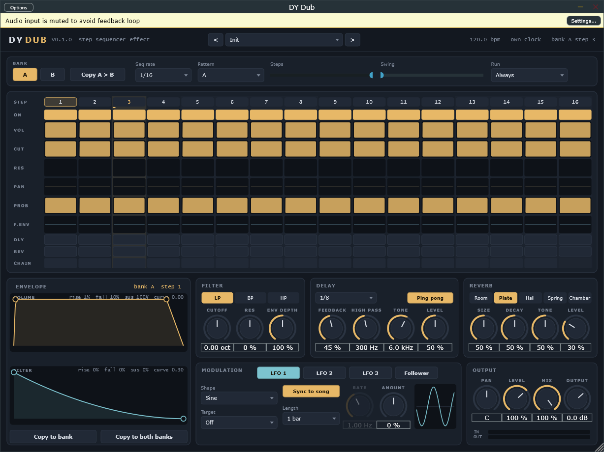

# DY Dub

A step sequencer for audio, as a VST3 effect. Every step has its own level, filter,
pan, chance, envelopes and delay / reverb sends, so a held chord turns into a
rhythm and a drum loop turns into something else.

## Quick start

1. Drop **DY Dub** on an audio track (or after an instrument) and press play.
2. Pick a preset at the top: *Dub Chords* on a held minor chord, *Chopped Drums* on a
   break, *Four-Bar Sweep* on a pad, *Echo Throws* on anything.
3. Draw in the lanes, click a step number to shape its envelopes.

## The sequencer

| Control | What it does |
|---|---|
| **Bank A / B** | 16 steps each. The buttons pick which bank you see; a dot marks the one playing |
| **Pattern** | Which bank plays on each pass: A, B, AB, AAB, ABB, AABB, AAAB, ABBB, AAAAAAAB |
| **Seq rate** | Length of one step, 1/32 to 1 bar (1/16 T, 1/8 T, 1/4 T too) |
| **Steps** | Steps per pass (1-16); shorter than 16 runs against the bar |
| **Swing** | Delays every second step, 50 % (straight) to 75 % |
| **Run** | *Always* keeps sequencing on its own clock while the song is stopped; *With transport* passes the input dry until you press play |

The sequencer follows the song position, so the same bar always plays the same
step, and probability decisions repeat exactly every time you play the song.

## Lanes (per step)

| Lane | |
|---|---|
| **ON** | Off steps leave a gap |
| **VOL** | Level of the step |
| **CUT / RES** | Filter cutoff (20 Hz - 20 kHz) and resonance; the type (LP / BP / HP) is global |
| **PAN** | Pan of the step, added to the global pan |
| **PROB** | Chance the step plays at all |
| **F.ENV** | How far the filter envelope moves the cutoff, in octaves (-5 .. +5) |
| **DLY / REV** | Send this step into the delay / the reverb: keep the pattern dry and throw one hit into the echo |
| **CHAIN** | Joins a step to the next: one longer step whose envelope runs across the whole block. The first step's values play |

Drag across bars to draw, click toggles (drag to paint the same state),
double-click a bar to reset it. Right-click a lane: set every step to one value,
reset, randomise, invert, or copy the lane to the other bank. **Copy A > B**
copies the whole bank.

## Envelopes

Click a step number. The envelope panel shows the **volume** and **filter**
envelopes of that step (or of its chained block): rise, sustain, fall, in
percent of the step so the shape holds at any tempo.

- drag the first node sideways: rise
- drag the second node: where the fall starts, and the sustain level
- drag anywhere else up / down: bend the curve
- double-click: reset; **Copy to bank** / **Copy to both banks** give every step this shape

## Delay and reverb

Ping-pong delay locked to the tempo (1/16 to 1/2, dotted and triplet), with a high
pass and a tone low pass inside the feedback, so repeats thin out instead of piling
up. Feedback at 100 % saturates instead of exploding; changing the time glides like
tape. Five reverbs: **Room, Plate, Hall, Spring, Chamber**, with size, decay, tone and
level. Only steps with DLY / REV on feed them; the tails ring through the gaps.

## Modulation

Three LFOs (sine, triangle, saw up, saw down, square, sample & hold; free in Hz or
locked to the song from 1/8 to 16 bars) and an **input follower** (attack / release;
positive amount opens its target as the input gets louder, negative ducks it).

**Right-click a knob** with a modulation target (cutoff, res, env depth, delay
feedback / level, reverb size / level, pan, level, mix) and pick a source. A ring
around the knob shows where the modulation has taken it right now. Each source has
one target; set the amount on its page.

## Output

Pan (auto-pan: LFO on it), level of the sequenced signal, dry / wet mix, output
gain, and input / output meters.

## Not yet

- modulating the per-step controls inside the grid
- per-bank step counts, user preset saving (the host's preset system works)
