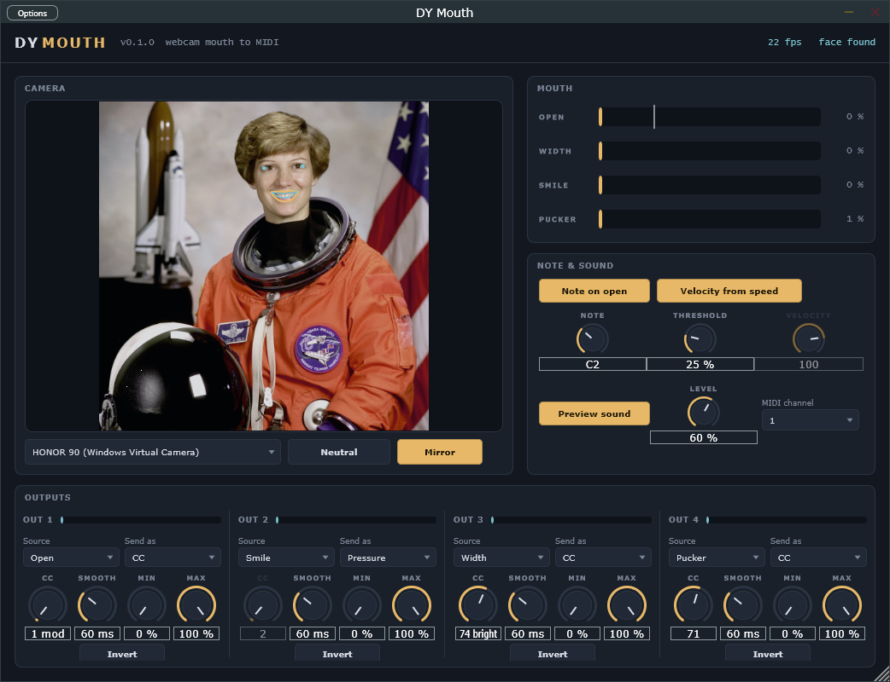

# DY Mouth

Your webcam follows your mouth, and your mouth plays Ableton Live (VST3, Windows).
How far it is open, how wide, smiling, puckered: each becomes a MIDI controller,
and opening your mouth can play a note. A built-in talk-box voice is on, so you hear
it as soon as it is on a track.

## How it works

The face is found and followed with Google's MediaPipe Face Landmarker models
(478 points on the face), converted to ONNX and run inside the plugin by ONNX
Runtime, on your own computer. No picture leaves it. Like MediaPipe, the face is
detected once and then followed from frame to frame, so it costs about 10 ms of one
CPU core per camera frame, on a thread of its own (never the audio thread).

From the lips and the eye corners it measures four shapes, in proportion to the
distance between the eyes and along the face's own axes, so moving closer to the
camera or tilting your head does not change them:

- **Open**: the inner lips apart.
- **Width**: corner to corner, wider than your neutral face.
- **Smile**: the corners lifted.
- **Pucker**: narrower than your neutral face ("oo").

**Neutral** (and the first face it sees) sets the zero: look at the camera with a
relaxed, closed mouth and click it.

## Outputs

Four outputs, each with:

- **Source**: Open, Width, Smile or Pucker.
- **Send as**: Off, **CC** (with its number), **Pitch bend** or **Pressure**
  (channel aftertouch).
- **Smooth**: glide, 0 to 1000 ms. Higher is calmer but slower.
- **Min / Max**: the output range, **Invert** turns it round.

Defaults: Open to CC 1 (mod wheel), Smile to Pressure, Width to CC 74 (brightness),
Pucker to CC 71.

**Note on open** plays **Note** when the mouth opens past **Threshold** (the mark on
the OPEN bar) and releases it when it closes again. **Velocity from speed**: snapping
the mouth open plays louder than opening it slowly.

**Preview sound** is a buzz through two vowel formants that follow your mouth.
Turn it off to play another instrument.

## Using it in Live

Drag **DY Mouth** onto a MIDI track and open its window. Windows has to allow desktop
apps to use the camera (Settings > Privacy & security > Camera), and only one app can
use the webcam at a time.

### Another instrument

Turn **Preview sound** off. On a second MIDI track set *MIDI From* to the DY Mouth
track, second box "DY Mouth", *Monitor* In, and put the instrument there. Live's
Wavetable and Operator take Mod Wheel and Pressure in their MIDI modulation (route
them to the filter, a wavetable position, anything); most third-party synths also
follow CC 74 and pitch bend.

### Any knob in Live

Live cannot MIDI-map the MIDI coming out of a track, so for that run the standalone
**DY Mouth.exe** next to Live with a virtual MIDI cable (for example loopMIDI) as its
MIDI output (Options > Audio/MIDI Settings). Turn that port's *Remote* on in Live's
MIDI preferences, press Ctrl+M, click any knob and move your mouth.

Expect about 40 to 70 ms from your mouth to the sound (the camera's 30 frames a
second set it), which is fine for sweeps and expression, not for tight drums.

## Building

From the repository root: `.\scripts\build.ps1`, then `.\scripts\install.ps1 -Module Mouth`
or `.\scripts\package.ps1 -Module Mouth`. The build fetches ONNX Runtime 1.31.1 and
copies its dll into the plugin as `DYMouth.onnxruntime.dll`.

- Engine tests: `build\Mouth\mouth_tests.exe`
- The tracker on a still picture: `build\Mouth\mouth_track_image.exe <onnxruntime.dll> Mouth\Models <picture.ppm>`
- The standalone with a picture instead of the camera: set `DYMOUTH_TEST_IMAGE` to a png.
- `Models\convert.py` rebuilds the ONNX models from MediaPipe's release.

The face models are MediaPipe Face Landmarker (Google, Apache 2.0).
