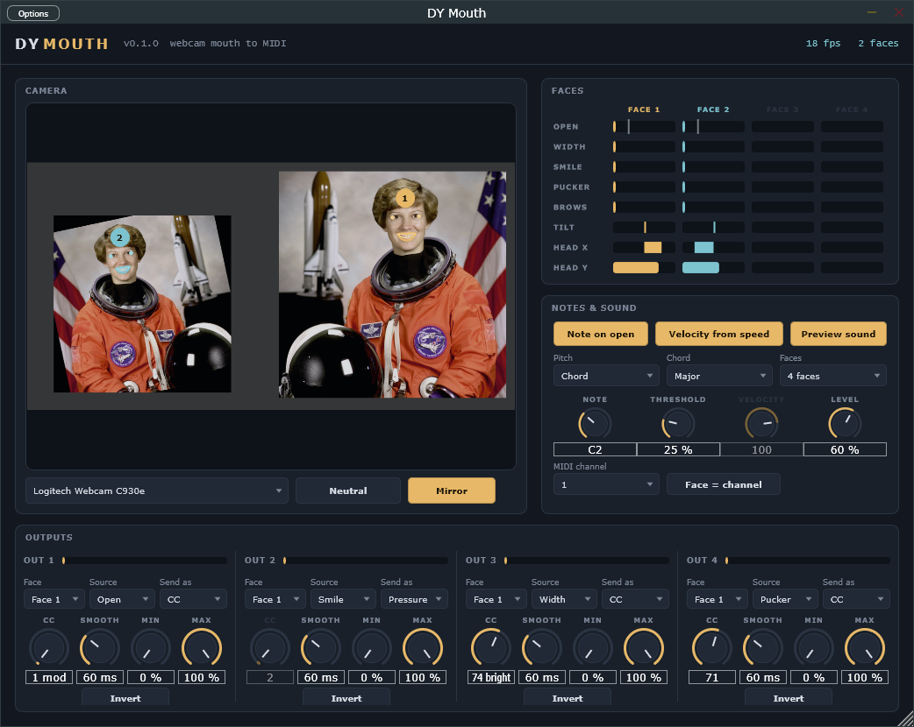

# DY Mouth

Your webcam follows your mouth, and your mouth plays Ableton Live (VST3, Windows).
Up to four people at once. How far each mouth is open, how wide, smiling, puckered,
the eyebrows, the head's tilt and where it is: each becomes a MIDI controller, and
every open mouth plays its own note. A built-in talk-box choir is on, so you hear it
as soon as it is on a track.

## How it works

The face is found and followed with Google's MediaPipe Face Landmarker models
(478 points on the face), converted to ONNX and run inside the plugin by ONNX
Runtime, on your own computer. No picture leaves it. Like MediaPipe, the face is
detected once and then followed from frame to frame, so it costs about 10 ms of one
CPU core per camera frame, on a thread of its own (never the audio thread).

Every face gets a number (1 to 4) and a colour, which it keeps while it stays in
view; a new face takes the lowest free number. The detector looks for newcomers in
the whole picture and in zoomed-in tiles, a tile a frame, so faces further back are
found too (within a couple of metres). **Faces** limits how many it follows (each
one costs about 8 ms a frame).

From the lips, eyes and brows it measures, in proportion to the distance between the
eyes and along the face's own axes (so moving closer or tilting does not change them):

- **Open**: the inner lips apart.
- **Width**: corner to corner, wider than the neutral face.
- **Smile**: the corners lifted.
- **Pucker**: narrower than the neutral face ("oo").
- **Brows**: eyebrows raised.
- **Tilt**: the head leaning to a shoulder, 50 % upright.
- **Head X / Head Y**: where the face is in the picture, as you see it (left to
  right, bottom to top).

**Neutral** sets the zero for every face in view: look at the camera with a relaxed,
closed mouth and click it. A face is also calibrated by itself the first time it
appears.

## Outputs

Four outputs, each with:

- **Source**: any of the eight above.
- **Send as**: Off, **CC** (with its number), **Pitch bend** or **Pressure**
  (channel aftertouch).
- **Smooth**: glide, 0 to 1000 ms. Higher is calmer but slower.
- **Min / Max**: the output range, **Invert** turns it round.
- **Face**: whose face it follows.

Defaults: Open to CC 1 (mod wheel), Smile to Pressure, Width to CC 74 (brightness),
Pucker to CC 71.

**Note on open**: every face plays a note while its mouth is open past **Threshold**
(the mark on its OPEN bar) and releases it when it closes. **Velocity from speed**:
snapping the mouth open plays louder than opening it slowly. Which note:

- **Pitch: Chord**: the faces share a **Chord** out (Unison, Major, Minor, Sus4,
  Fifths, Octaves), face 1 the root on **Note**. A choir.
- **Pitch: Head height**: each face sings up a **Scale** as the head rises, two
  octaves from **Note**, gliding legato while the mouth stays open. A face theremin.

Two faces on the same note never cut each other off. **Face = channel** puts face 1
on the MIDI channel, face 2 on the next and so on, for one instrument per face.

**Preview sound** is one talk-box voice per face: a buzz through two vowel formants
that follow that mouth, placed left or right where the face is, and a head tilt bends
it up to two semitones. Turn it off to play another instrument.

## Using it in Live

Drag **DY Mouth** onto a MIDI track and open its window. Windows has to allow desktop
apps to use the camera (Settings > Privacy & security > Camera), and only one app can
use the webcam at a time.

### Another instrument

Turn **Preview sound** off. On a second MIDI track set *MIDI From* to the DY Mouth
track, second box "DY Mouth", *Monitor* In, and put the instrument there. Live's
Wavetable and Operator take Mod Wheel and Pressure in their MIDI modulation (route
them to the filter, a wavetable position, anything); most third-party synths also
follow CC 74 and pitch bend.

A different instrument per person: turn **Face = channel** on and play a multitimbral
instrument or hardware synth, which split by channel (Live's own tracks cannot filter
their MIDI input by channel). Inside Live, **Pitch: Chord** with Octaves and a Pitch
device in Block mode per receiving track, as with DY Pendulum's layers, does the same.

### Any knob in Live

Live cannot MIDI-map the MIDI coming out of a track, so for that run the standalone
**DY Mouth.exe** next to Live with a virtual MIDI cable (for example loopMIDI) as its
MIDI output (Options > Audio/MIDI Settings). Turn that port's *Remote* on in Live's
MIDI preferences, press Ctrl+M, click any knob and move your mouth.

Expect about 40 to 70 ms from your mouth to the sound (the camera's 30 frames a
second set it), which is fine for sweeps and expression, not for tight drums.

## Building

From the repository root: `.\scripts\build.ps1`, then `.\scripts\install.ps1 -Module Mouth`
or `.\scripts\package.ps1 -Module Mouth`. The build fetches ONNX Runtime 1.31.1 and
copies its dll into the plugin as `DYMouth.onnxruntime.dll`.

- Engine tests: `build\Mouth\mouth_tests.exe`
- The tracker on a still picture: `build\Mouth\mouth_track_image.exe <onnxruntime.dll> Mouth\Models <picture.ppm>`
- The standalone with a picture instead of the camera: set `DYMOUTH_TEST_IMAGE` to a png.
- `Models\convert.py` rebuilds the ONNX models from MediaPipe's release.

The face models are MediaPipe Face Landmarker (Google, Apache 2.0).
