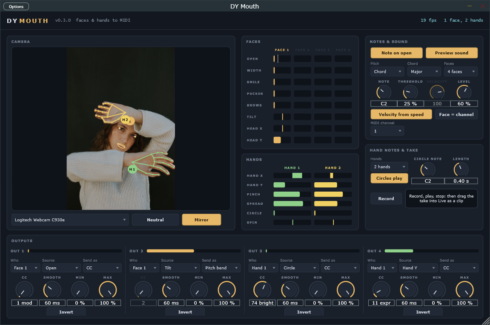

# DY Mouth

Your webcam follows your faces and hands, and they play Ableton Live (VST3, Windows).
Up to four faces and two hands at once. Every open mouth sings its own note, every
circle a hand draws rings one (big circles low, small ones high, fast ones loud), and
everything else, from a smile to how high your hand is, becomes a MIDI controller.
Built-in talk-box voices and a bell are on, so you hear it as soon as it is on a track.
Record a take and drag it into Live as a clip.

## How it works

Faces and hands are found and followed with Google's MediaPipe Face and Hand
Landmarker models (478 points on a face, 21 on a hand), converted to ONNX and run
inside the plugin by ONNX Runtime, on your own computer. No picture leaves it. Like
MediaPipe, each face or hand is detected once and then followed from frame to frame;
the detector keeps looking for newcomers in the whole picture and in zoomed-in tiles,
a tile at a time, so people further back are found too (within a couple of metres).
Faces and hands are tracked on two threads at the same time (two cores), never on the
audio thread, and the model's worker threads sleep between frames instead of spinning.

Every face and hand gets a number and a colour, kept while it stays in view; a
newcomer takes the lowest free number. **Faces** and **Hands** limit how many are
followed (each face costs about 8 ms a frame, each hand about 10 ms).

### Faces

Measured in proportion to the distance between the eyes and along the face's own axes
(moving closer or tilting does not change them):

- **Open**: the inner lips apart.
- **Width**: corner to corner, wider than the neutral face.
- **Smile**: the corners lifted.
- **Pucker**: narrower than the neutral face ("oo").
- **Brows**: eyebrows raised.
- **Tilt**: the head leaning to a shoulder, 50 % upright.
- **Head X / Head Y**: where the face is in the picture, as you see it.

**Neutral** sets the zero for every face in view: look at the camera with a relaxed,
closed mouth and click it. A face is also calibrated by itself the first time it
appears. **Auto range**: every face moves differently, so each shape remembers the
furthest this face has taken it (forgetting slowly, over about a minute) and that is
100 %; a floor keeps small twitches small. Smile big once and the smile bar uses the
whole range from then on.

### Hands

- **Hand X / Hand Y**: where the palm is, as you see it.
- **Pinch**: thumb and index fingertips together.
- **Spread**: a fist is 0, an open hand 1.
- **Circle**: the size of the circle the hand is drawing right now (0 when it is not).
- **Spin**: how fast it goes round, 50 % still, towards 100 % clockwise and 0 %
  anticlockwise (as you see it).

Any circle counts: the palm's recent path is followed and every full turn around its
middle is one circle, whatever its size, speed or direction (a straight swipe never
counts). The camera view draws each hand's path, brighter while it circles, and a ring
flies out when a circle is done.

## Notes

**Note on open**: every face plays a note while its mouth is open past **Threshold**
(the mark on its OPEN bar) and releases it when it closes. **Velocity from speed**:
snapping the mouth open plays louder. Which note:

- **Pitch: Chord**: the faces share a **Chord** out (Unison, Major, Minor, Sus4,
  Fifths, Octaves), face 1 the root on **Note**. A choir.
- **Pitch: Head height**: each face sings up a **Scale** as the head rises, two
  octaves from **Note**, gliding legato while the mouth stays open. A face theremin.

**Circles play**: every circle a hand completes plays a note of **Length**: the biggest
circle plays **Circle note**, smaller ones climb two octaves of the **Scale**, and the
faster it went round the louder.

Two players on the same note never cut each other off. **Face = channel** puts face 1
on the MIDI channel, face 2 on the next and so on, the hands after the faces.

**Preview sound**: one talk-box voice per face (a buzz through two vowel formants
that follow that mouth; a smile brightens it, raised brows add vibrato, a head tilt
bends it up to two semitones, and it sits left or right where the face is) and a bell
for the circles, placed where the hand is. Turn it off to play another instrument.

## Outputs

Four outputs, each with **Who** (Face 1 to 4, Hand 1 or 2), **Source** (the shapes of
that face or hand), **Send as** (Off, **CC** with its number, **Pitch bend** or
**Pressure**), **Smooth** (0 to 1000 ms), **Min / Max** and **Invert**.

Defaults: face 1's Open to CC 1 (mod wheel), face 1's Tilt to Pitch bend, hand 1's
Circle to CC 74 (brightness), hand 1's height to CC 11 (expression).

## The take

**Record**, play, click it again: everything DY Mouth played (notes, CCs, pitch bend,
pressure) is kept. Drag the box next to it into Live, onto a MIDI track or the
arrangement, and it becomes a clip at the tempo you recorded at.

You can also record in Live itself: on a second MIDI track set *MIDI From* to the
DY Mouth track, second box "DY Mouth", arm it and record. (Arming the DY Mouth track
itself records what comes *in* to it, not what it plays.)

## Using it in Live

Drag **DY Mouth** onto a MIDI track and open its window. Windows has to allow desktop
apps to use the camera (Settings > Privacy & security > Camera), and only one app can
use the webcam at a time.

### Another instrument

Turn **Preview sound** off. On a second MIDI track set *MIDI From* to the DY Mouth
track, second box "DY Mouth", *Monitor* In, and put the instrument there. Live's
Wavetable and Operator take Mod Wheel, Pressure and Pitch Bend in their MIDI
modulation; most third-party synths also follow CC 74 and CC 11.

A different instrument per person: turn **Face = channel** on and play a multitimbral
instrument or hardware synth, which split by channel (Live's own tracks cannot filter
their MIDI input by channel).

### Any knob in Live

Live cannot MIDI-map the MIDI coming out of a track, so for that run the standalone
**DY Mouth.exe** next to Live with a virtual MIDI cable (for example loopMIDI) as its
MIDI output (Options > Audio/MIDI Settings). Turn that port's *Remote* on in Live's
MIDI preferences, press Ctrl+M, click any knob and move.

Expect about 40 to 70 ms from a movement to the sound (the camera's 30 frames a
second set it), which is fine for sweeps and expression, not for tight drums.

## Building

From the repository root: `.\scripts\build.ps1`, then `.\scripts\install.ps1 -Module Mouth`
or `.\scripts\package.ps1 -Module Mouth`. The build fetches ONNX Runtime 1.31.1 and
copies its dll into the plugin as `DYMouth.onnxruntime.dll`.

- Engine tests: `build\Mouth\mouth_tests.exe`
- The trackers on a still picture: `build\Mouth\mouth_track_image.exe <onnxruntime.dll> Mouth\Models <picture.ppm>`
- The standalone with a picture instead of the camera: set `DYMOUTH_TEST_IMAGE` to a png.
- `Models\convert.py` rebuilds the ONNX models from MediaPipe's release.

The face and hand models are MediaPipe Face and Hand Landmarker (Google, Apache 2.0).
