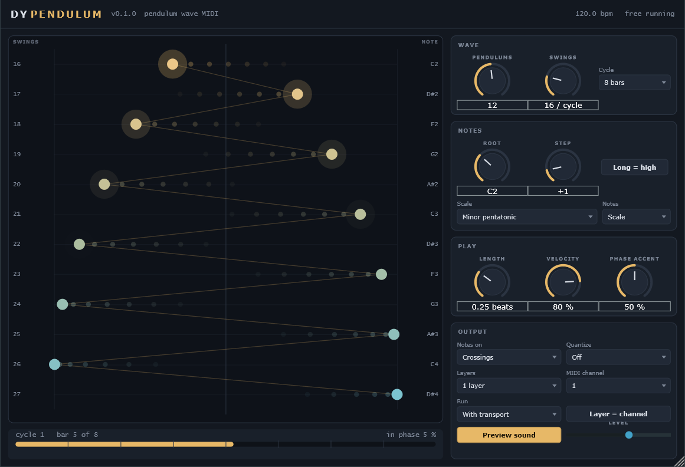

# DY Pendulum

A pendulum wave as a MIDI generator for Ableton Live (VST3, Windows). A row of
pendulums is released together; each one swings a little faster than the one
before, so they drift apart into travelling waves, spirals and apparent chaos, and
then come back into one line at the end of every cycle. Every swing through the
middle plays that pendulum's note.

## How it works

Pendulum *k* makes exactly **Swings + k** full swings per **Cycle**. That is the
whole trick of a real pendulum wave (the lengths are chosen so the periods are
Γ / (N + k)), and it is exact here: positions and note times are a function of
the song position, so the same bar always plays the same notes, the cycle lines
up with Live's bars, and the buffer size makes no difference (tested).

- **Pendulums** (1 to 24), **Swings** (of the longest one per cycle), **Cycle**
  (1 to 64 bars).
- **Notes on**: *Crossings* (both directions through the middle), *Rightward* or
  *Leftward* only (half as many), or *Turns* (the ends of the swing: every cycle
  starts with all of them together, as a chord).
- **Quantize**: *Off* keeps the exact physical timing, which drifts against the
  grid in poly-rhythms; or snap to 1/32 up to 1/4 (a pendulum never plays twice
  in one slot).
- **Root**, **Scale** (14 scales) and **Step** (scale degrees between neighbours):
  the longest pendulum plays the root, each shorter one climbs the scale;
  **Long = high** turns it round.
- **Length**, **Velocity**, and **Phase accent**: notes get louder the more the
  pendulums are in phase, so the moments when they line up stand out.
- **Preview sound**: a soft built-in bell so it is audible as soon as it is on a
  track. Turn it off to play another instrument from its MIDI output.
- **Run**: *With transport* (plays while Live plays, follows the song position)
  or *Always*. The standalone app always runs.

The display shows the pendulums from above, one row each with its swing count and
note; a bob flashes as it plays. Below it, where you are in the cycle and how much
in phase the pendulums are right now.

## Using it in Live

Drag **DY Pendulum** onto a MIDI track and press play: the built-in bell plays.
To drive your own instrument, turn **Preview sound** off, and on a second MIDI
track set *MIDI From* to the DY Pendulum track, second box "DY Pendulum",
*Monitor* In, and put the instrument there.

### Driving other tracks

Every track that sets *MIDI From* to the DY Pendulum track (second box "DY
Pendulum", Monitor In) receives the whole wave; Live cannot filter a track's MIDI
input by channel, so DY Pendulum splits the wave by notes instead:

- **Notes: Drum pads**: pendulum 1 plays C1, the next C#1, and so on. Send it to
  a Drum Rack and every pendulum is its own pad / sample.
- **Layers** (1 to 4): neighbouring pendulums form groups, and each group plays
  its scale in its own two-octave band above the root (layer 1 from the root,
  layer 2 two octaves up, ...). On each receiving track put Live's **Pitch**
  device first, mode *Block*, with *Lowest* at the start of the band you want and
  *Range* 24, and transpose back down with Pitch if you like: one track plays the
  long, slow pendulums, another the fast ones.
- **Layer = channel** also puts each layer on its own MIDI channel, for
  multitimbral instruments and hardware synths, which do filter by channel.

Long cycles (16 to 64 bars) make slow-evolving patterns for ambient and minimal; short cycles with Quantize make
tight, shifting poly-rhythms.

## Building

From the repository root: `.\scripts\build.ps1`, then
`.\scripts\install.ps1 -Module Pendulum` or `.\scripts\package.ps1 -Module Pendulum`.
Engine tests: `build\Pendulum\pendulum_tests.exe`.
